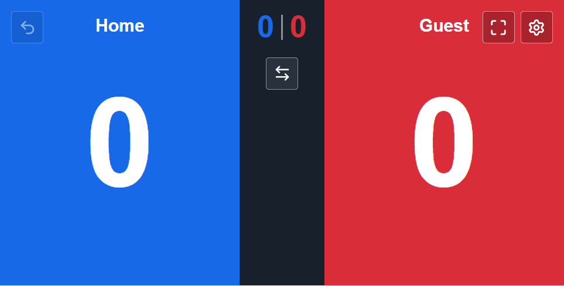
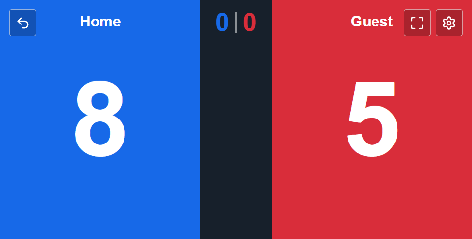
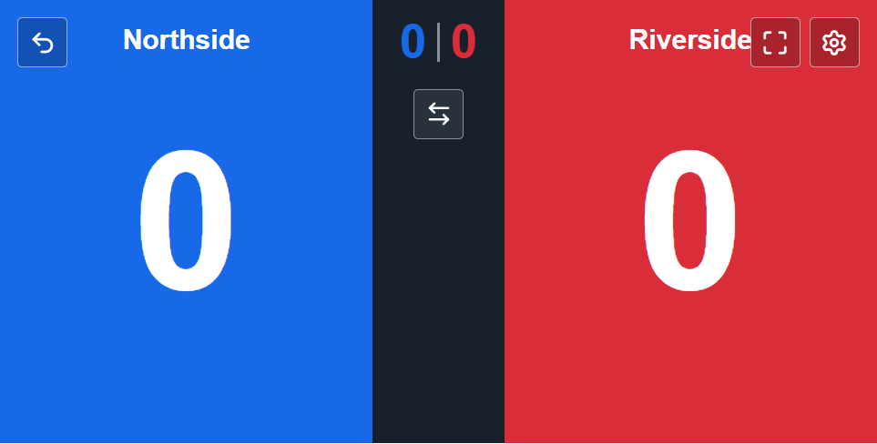
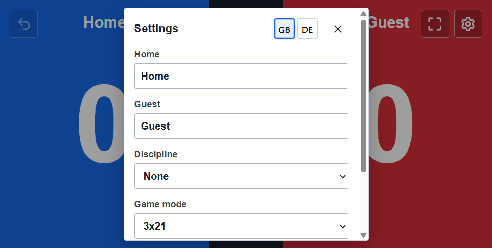
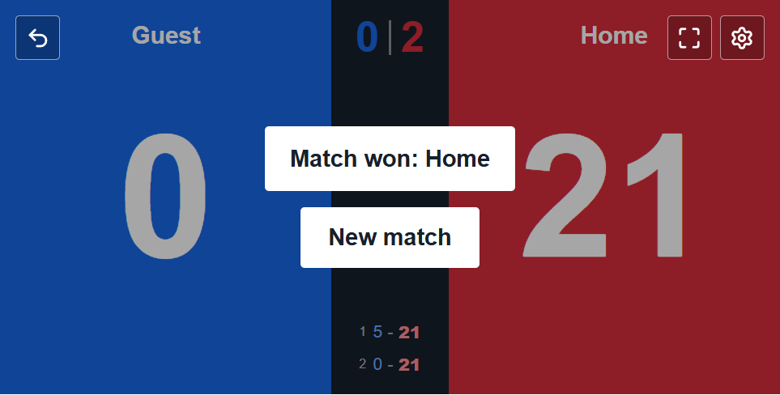
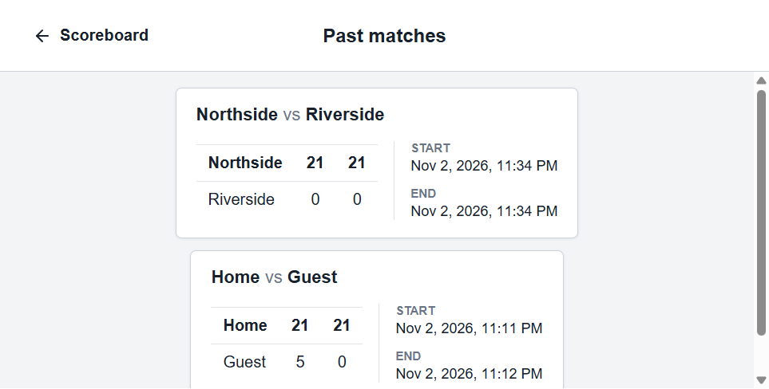

# Badminton Scoreboard

A simple, touch-friendly scoreboard for tracking badminton games and matches. The app supports multiple scoring formats, configurable team names and disciplines, undo, match history, and English or German UI. It follows the browser language by default; the language can also be changed from Settings.

## Run Locally

```bash
npm install
npm run dev
```

Open the local URL printed by Vite.

## How to Use

- Tap a team's side of the scoreboard to add a point.
- Use **Undo** to reverse the latest scoring action.
- When a game ends, choose the next game to continue the match. The match is saved to history when complete.
- Use **Switch sides** before scoring if the teams need to change ends.
- Use the fullscreen control for a larger court-side display.
- Open **Settings** and choose **Past matches** to review completed results.

## Scoring Formats

| Format | Games to win | Points to win a game | Point cap |
| --- | ---: | ---: | ---: |
| 3x21 | 2 of 3 | 21 | 30 |
| 3x15 | 2 of 3 | 15 | 21 |
| 5x11 | 3 of 5 | 11 | 15 |

A game normally requires a two-point lead. The point cap ends the game even if the lead is smaller.

## Settings

The Settings menu lets you edit the Home and Guest team names, choose a badminton discipline, and select a scoring format. The flag buttons switch between German and English; that choice is saved for future visits. You can also open past matches or reset the current score and match history.

Completed matches are stored in the browser's local storage on the current device.

## Project Checks

```bash
npm test
npm run typecheck
npm run build
```

## Screenshots

### Starting Scoreboard



### Game in Progress



### Renamed Teams



### Settings



### Match Complete



### Past Matches


